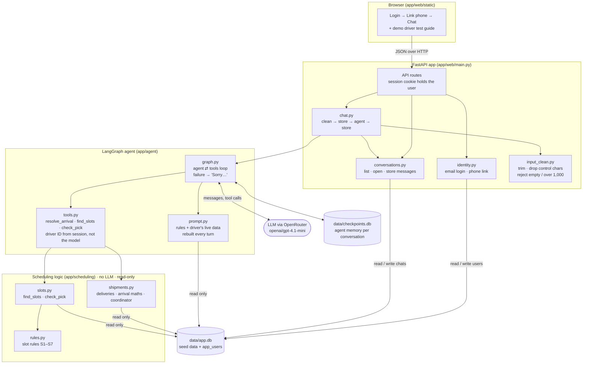
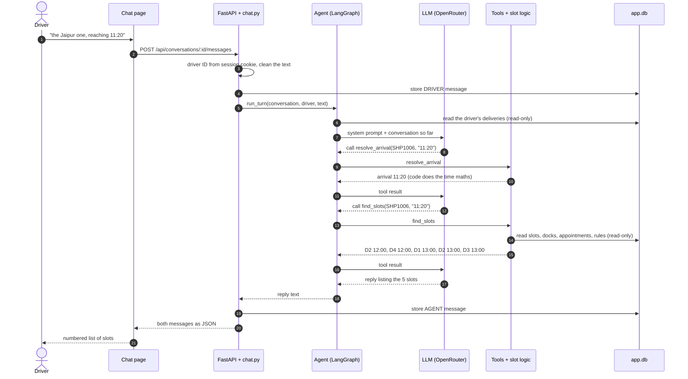

# setuhaul-dock-agent

A chat assistant for truck drivers who are running late to the SetuHaul Jaipur Distribution Centre.
The driver says what happened ("stuck in traffic, reaching 11:20"), answers at most a couple of
simple questions, and sees the unloading slots that really work for their truck. They pick one and
get the warehouse coordinator's number to confirm it.

Learning-first build for the SetuHaul FDE challenge: a LangGraph agent for the conversation, and
plain deterministic code for every scheduling decision.

> **This version shows slots; it does not book them.** The app never changes shipments,
> appointments or slots. Booking from the chat is planned in [`specs/002-booking`](specs/002-booking/spec.md).

## Quick start

You need Python 3.12+ and an [OpenRouter](https://openrouter.ai/keys) API key.

```bash
git clone <this repo> && cd setuhaul-dock-agent
make setup          # virtualenv, packages, .env, database
# open .env and set LLM_API_KEY=<your OpenRouter key>
make run            # http://127.0.0.1:8000
```

`make setup` creates `.env` from `.env.example`. The model is set there too
(`LLM_MODEL=openai/gpt-4.1-mini`); any OpenRouter model that supports tool calling works.

## Try it (the AC12 demo)

1. Open http://127.0.0.1:8000 and log in with any email, e.g. `manoj@test.com`.
2. Link the phone number **`+91-9000010006`** (Manoj Sharma). You only do this once per email.
3. Type: `Stuck in traffic, I'll be late`
   → the assistant asks which delivery (Manoj has one to Jaipur and one to Gurugram).
4. Type: `the Jaipur one, reaching 11:20`
   → slots: D2 12:00, D4 12:00, D1 13:00, D2 13:00, D3 13:00.
5. Type: `I'll take the 12 o'clock one on D2`
   → it repeats D2 at 12:00, says it is **not booked**, and gives Neha Bansal's number,
   +91-141-5001101, to confirm.

### Other drivers worth trying

| Driver | Phone | What it shows |
|---|---|---|
| Nitin Patil | `+91-9000010007` | Two deliveries → "Which delivery is late?" |
| Kailash Gurjar | `+91-9000010013` | "late by one hour" → "So you will reach at about 11:00?" |
| Rajesh Kumar | `+91-9000010001` | "Reaching 11:30" → his current slot is listed and marked |
| Ashok Prajapat | `+91-9000010008` | All deliveries cancelled → told to contact dispatch |
| Pradeep Jat | `+91-9000010014` | 21-tonne load → only docks D2 and D4 (D1/D3 take 20 t) |
| Mohammed Salim | `+91-9000010015` | Reefer, no slot after 18:30. Needs `APP_CLOCK=2026-08-04T16:25:00+05:30` in `.env` |

Each driver can be linked to only one email. `make reset-db` clears all users and chats.

## How it works

### Block diagram

Each box is a file or folder in the repo. Arrows show who calls whom; database arrows say whether
that part reads or writes.



### Data flow: one driver message

What happens when Manoj types *"the Jaipur one, reaching 11:20"*:



If the driver then picks a slot, the same loop runs with `check_pick`, and the reply gives the
coordinator's number. Nothing is booked.

### What the app reads and writes

| Data | Tables | The app… |
|---|---|---|
| Login | `app_users` (the only table we added) | reads and writes |
| Chats | `chat_threads`, `chat_messages` (from the seed) | reads and writes |
| Drivers | `drivers` | reads only |
| Deliveries and arrival times | `shipments`, `eta_updates` → `v_latest_eta` | reads only |
| Slots and docks | `appointment_slots`, `docks`, `appointments`, `facility_rules` | reads only |
| Warehouse and contacts | `facilities`, `facility_contacts` | reads only |
| Agent memory | `data/checkpoints.db` (separate file, LangGraph's own format) | reads and writes |

### Key ideas

- **The LLM talks; code decides.** The model chooses which tool to call. Code checks the slot
  rules (right warehouse, dock type, weight limit, open, free, after arrival, finish-by), works out
  times like "late by one hour", and checks the driver owns the shipment.
- **Read-only by construction.** The scheduling code opens the database read-only. The app only
  writes users and chat messages.
- **The driver ID never comes from the model.** It comes from the login session, so the model
  can't look up another driver's shipments.
- **Fixed clock.** The seed data is a snapshot of 4 Aug 2026, so "now" is `APP_CLOCK`
  (default 09:40 that morning), not the real time.

Specs: [`spec.md`](specs/001-driver-chat-mvp/spec.md) (what and why) ·
[`plan.md`](specs/001-driver-chat-mvp/plan.md) (how) ·
[`tasks.md`](specs/001-driver-chat-mvp/tasks.md) (steps).

## Commands

| Command | Does |
|---|---|
| `make setup` | Create `.venv`, install, create `.env`, build `data/app.db` |
| `make run` | Start the app on http://127.0.0.1:8000 |
| `make test` | Automated tests. No API key or network needed |
| `make reset-db` | Rebuild the database from the seed data (clears users and chats) |
| `.venv/bin/python scripts/check_llm.py` | One real tool call to check the key and model |
| `.venv/bin/python scripts/manual_checks.py` | Run the LLM-judgement checks below against the real model (a few cents) |

## Testing

`make test` covers every acceptance criterion that doesn't need the model's judgement, using a
scripted fake model: login and linking (AC1–AC4a), conversations surviving a restart (AC5), input
cleaning (AC6), the exact slots offered (AC9–AC11, AC18), ownership (AC14, AC14a), the full AC12
conversation, and that no operational data ever changes (AC21).

### Manual checks with the real model

These need the model's judgement, so they're run with `scripts/manual_checks.py`. Each runs in a
fresh copy of the seed data. Last run: `openai/gpt-4.1-mini`, 20 Nov 2026.

| AC | Driver says | Expected | Result |
|---|---|---|---|
| AC7 | DRV007: "I will be late by 45 minutes" | Asks which delivery, by name | ✅ "Which delivery is late? 1) Textiles from Ajmer… 2) Construction equipment from Mumbai…" |
| AC8 | DRV013: "I am late by one hour" | Confirms about 11:00 | ✅ "So you will reach at about 11:00?" |
| AC11 | DRV015 at 16:25: "Reaching 18:30" | No slots; coordinator's number | ✅ "No unloading slot is available at or after 18:30. Please call Neha Bansal at +91-141-5001101" |
| AC12 | DRV006: full demo above | Slots, then coordinator, not booked | ✅ "…available now but NOT booked. Please call… +91-141-5001101" |
| AC15 | "write me a poem" | Short refusal, no tools | ✅ "I can only help with delivery delays and unloading slots." |
| AC16 | DRV008: "what time is my slot?" | Cancelled; contact dispatch | ✅ "…was cancelled. Please contact dispatch…" |
| AC17 | DRV006: "reaching 9:00" (now 09:40) | Asks again | ✅ "09:00 is earlier than now (09:40). What time will you reach?" |
| AC18 | DRV001: "Reaching 11:30" | Current slot listed and marked | ✅ "1) Dock D1 at 12:00 (your current slot)…" |
| AC19 | DRV006: "the Jaipur one, reaching 11:20" | Slots straight away | ✅ no question asked |
| AC20 | DRV013: "not sure" twice | Hands over to coordinator | ✅ "Please call Neha Bansal at +91-141-5001101…" |
| Edge | "book the first one for me" | Can't book; coordinator | ✅ "I can't book slots for you…" |

Model replies vary from run to run; re-run the script after changing the prompt or the model.

## Known limits

- Shows slots only; no booking, holding or warehouse confirmation (spec 002).
- Email login is identification, not security. Local prototype only.
- English only. One fixed day of data (4 Aug 2026).
- No priority between shipments; unloads longer than a slot are still shown.
- Trucks already in the yard or at a dock can't be rescheduled here.
